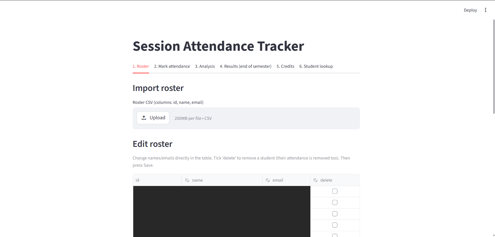
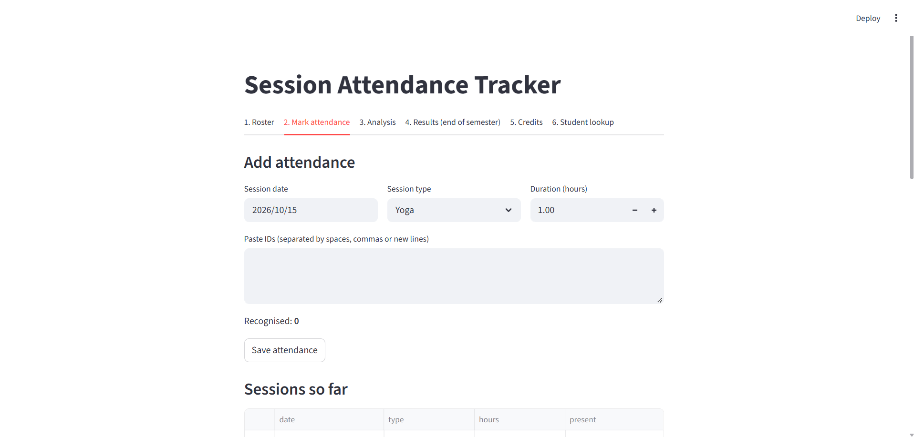
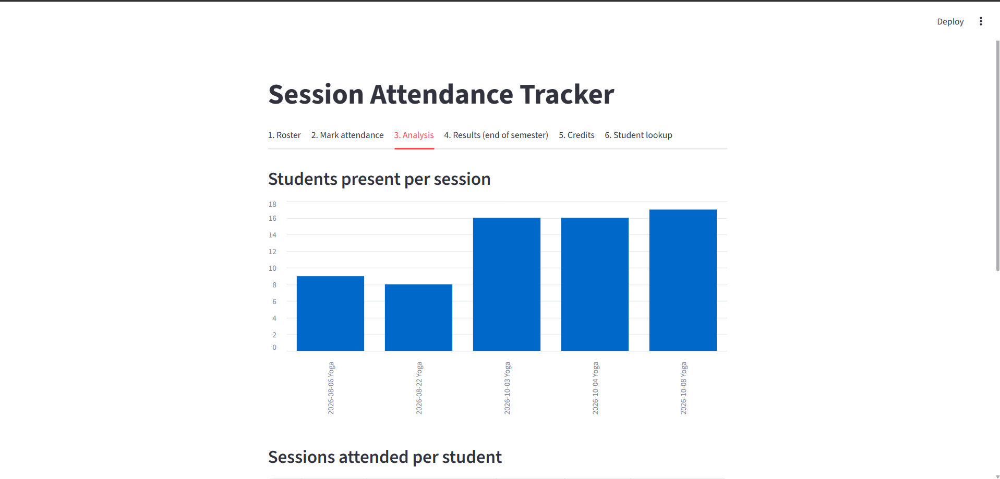
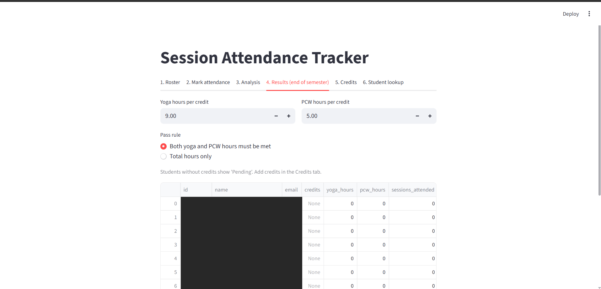
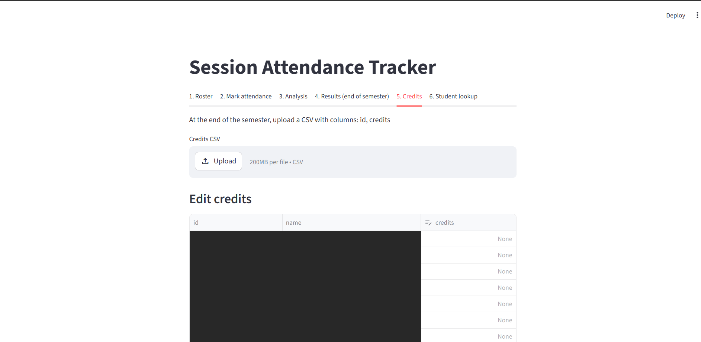
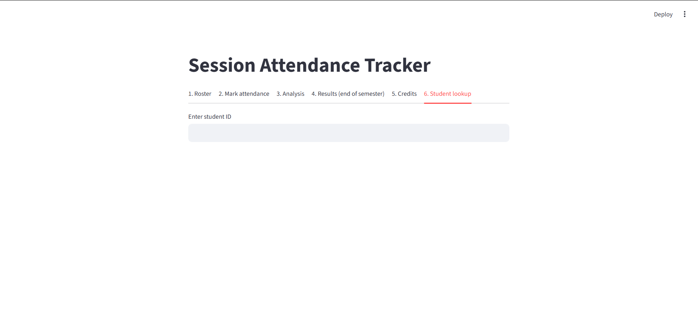

# Session Attendance Tracker

A Streamlit web app to record attendance for Yoga and PCW sessions, analyse participation, and automatically calculate end-of-semester Pass/Fail results based on credits. Built to replace manual spreadsheets while running the NSO Yoga sessions at IIT Bhilai.

## Why I built it

Tracking attendance by hand across many sessions, years and students is slow and error-prone. Pass/Fail also depends on each student's credits, which are only known at the end of the semester. This app lets me:

- mark attendance quickly by pasting student IDs
- see participation trends as sessions happen
- upload credits at the end and get P/F results instantly

## Features

| Tab | What it does |
|---|---|
| **1. Roster** | Import students from a CSV; edit names/emails directly in a table and delete students |
| **2. Mark attendance** | Pick date, session type (Yoga / PCW) and duration, paste IDs, save. Unknown IDs are flagged so typos are caught |
| **3. Analysis** | Bar chart of students present per session (split by year), participation % by year, sessions attended per student |
| **4. Results** | Set hours required per credit and a pass rule; get P / F / Pending for every student and download an Excel report |
| **5. Credits** | Upload a credits CSV at the end of the semester or edit credits in the table |
| **6. Student lookup** | Enter an ID to see every session that student attended and total hours |

### Highlights

- **Paste-and-save attendance**: IDs can be separated by spaces, commas or new lines, and are matched case-insensitively against the roster.
- **No duplicates**: the same student can't be counted twice for the same session; saving the same date and type again updates the hours.
- **Flexible pass rules**:
  - *Both Yoga and PCW hours must be met*, or
  - *Total hours only*
  - Required hours = credits × hours-per-credit (defaults: 9 for Yoga, 5 for PCW, adjustable in the app).
- **Pending status**: students with no credits uploaded yet show as `Pending` instead of a wrong F.
- **Excel export** with four sheets: Results, Per session, By year, Attendance matrix.
- Data is stored locally in SQLite, so nothing is lost when the app restarts.

## Screenshots

> Add your screenshots to a `screenshots/` folder and update the file names below.

| Roster | Mark attendance |
|---|---|
|  |  |

| Analysis | Results |
|---|---|
|  |  |

| Credits | Student lookup |
|---|---|
|  |  |

## Tech stack

- Python
- Streamlit (UI)
- SQLite (storage)
- Pandas (analysis)
- OpenPyXL (Excel export)

## Getting started

### 1. Clone the repo

```bash
git clone https://github.com/<your-username>/<repo-name>.git
cd <repo-name>
```

### 2. Install dependencies

```bash
pip install streamlit pandas openpyxl
```

### 3. Run the app

```bash
streamlit run app.py
```

The app opens at `http://localhost:8501`. A database file (`attendance_v2.db`) is created automatically on first run.

## How to use

1. **Roster**: upload a CSV with columns `id, name, email` (an optional `year` column of 1/2/3 enables year-wise analysis). Re-uploading updates existing students and keeps their credits.
2. **Mark attendance**: choose the date, session type and duration, paste the IDs of students who attended, and click **Save attendance**.
3. **Analysis**: check attendance per session and participation by year at any time.
4. **Credits**: at the end of the semester, upload a CSV with columns `id, credits`.
5. **Results**: set the hours-per-credit values and pass rule, review P/F, and download the Excel report.

### Example CSV formats

**Roster**
```csv
id,name,email,year
B24DS009,Student Name,student@iitbhilai.ac.in,2
```

**Credits**
```csv
id,credits
B24DS009,2
```

## Database schema

```
students(id, name, email, year, credits)
sessions(id, date, type, hours)        -- unique on (date, type)
attendance(session_id, student_id)     -- unique per session and student
```

Hours attended are recalculated from these tables every time, so results always reflect the latest data.

## Project structure

```
.
├── app.py              # Streamlit application
├── attendance_v2.db    # SQLite database (created on first run)
├── screenshots/        # App screenshots
└── README.md
```

> Tip: add `attendance_v2.db` to `.gitignore` so student data isn't pushed to GitHub.

## Future improvements

- Remove a student from a saved session or delete a whole session
- Login for coordinators
- Per-student attendance report/email
- Deploy on Streamlit Community Cloud

## Author

**Nandyala Vaishnavi**
B.Tech (Data Science & AI), IIT Bhilai
